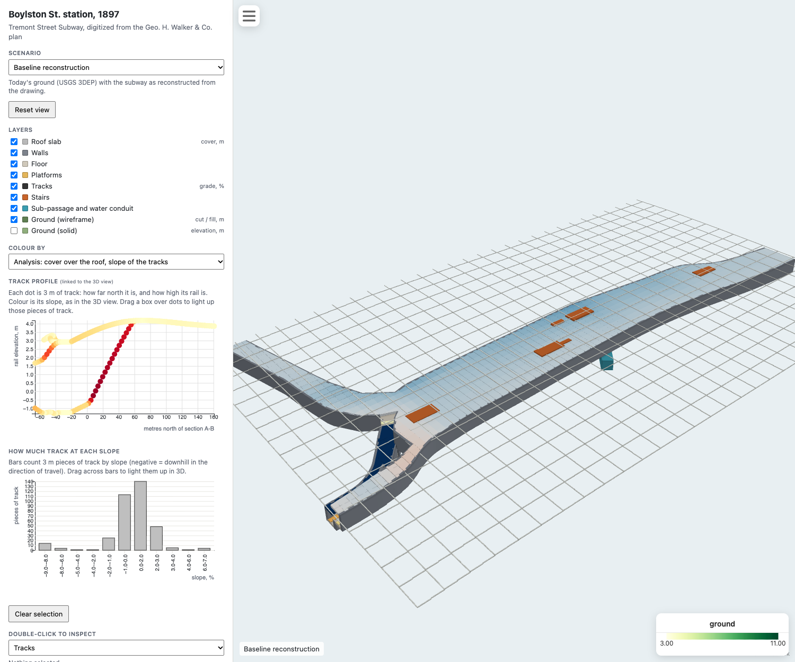
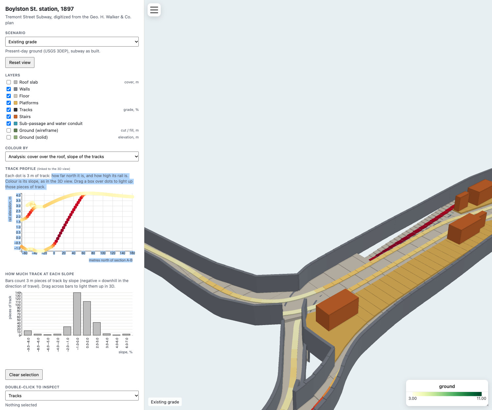
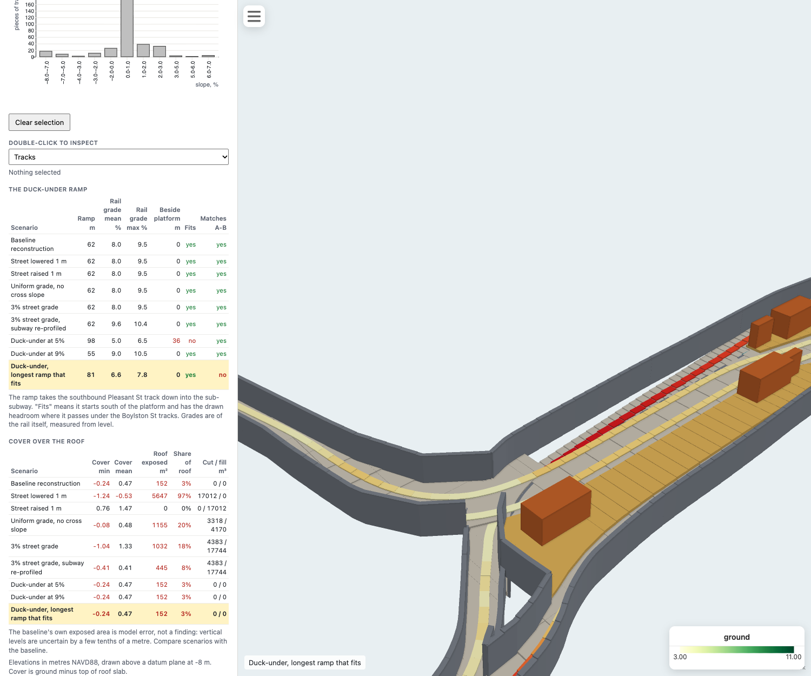
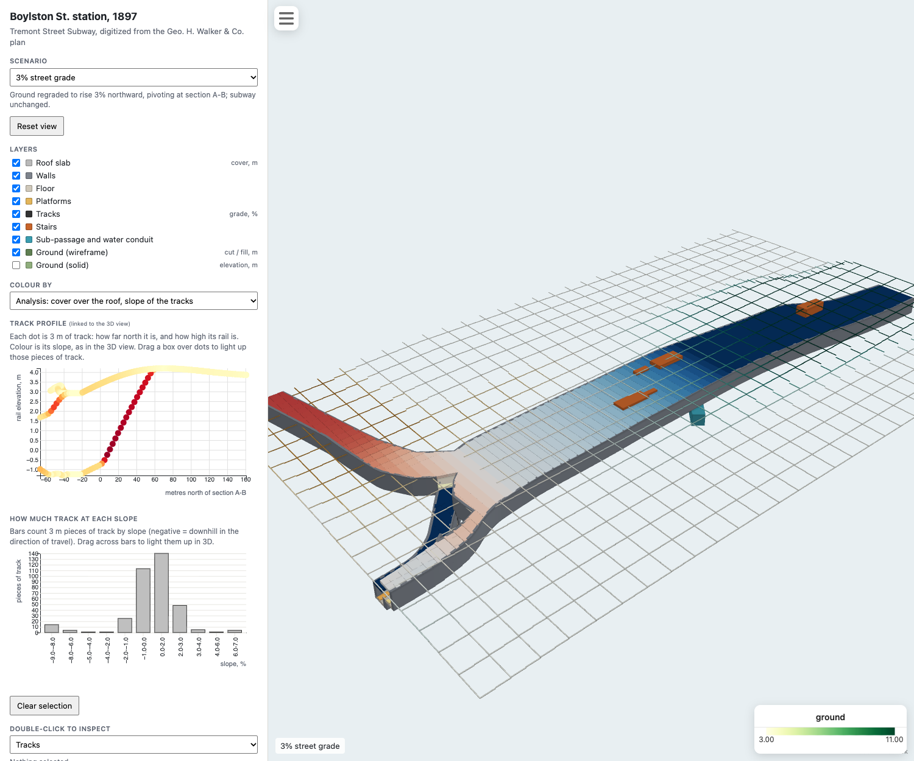
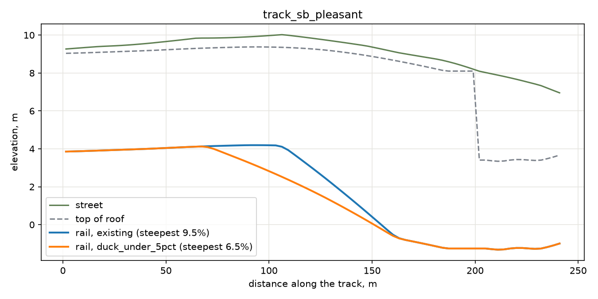
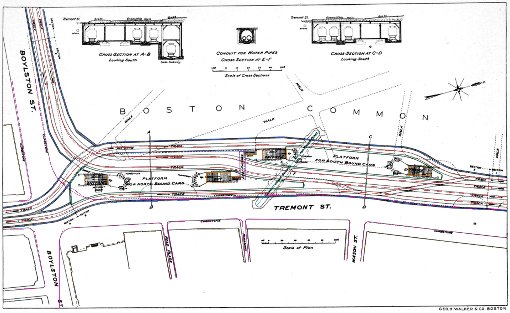
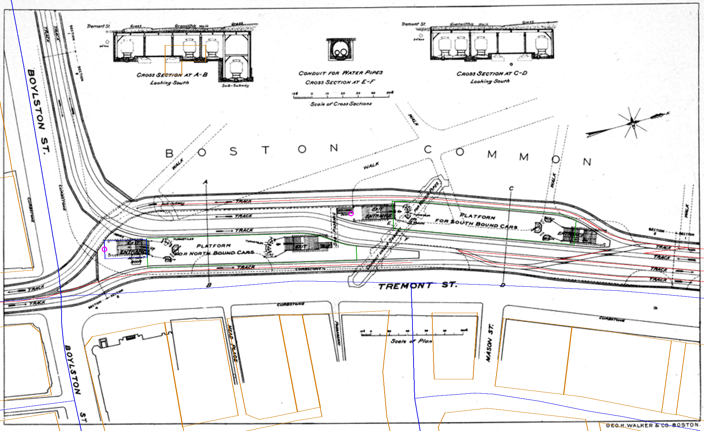

# Boylston St. station, 1897: a 3D model of the station and its duck-under

*This model was created for Claudia Wysocky's project at Boston University (the VANTAGE research
initiative), which studies the engineering of the early Boston subway and the duck-under at
Boylston Street station.*

It turns one historical drawing into a 3D model you can explore in a web browser, with linked
plots beside it, and uses it to look at two questions:

> **1. How steep is the duck-under, and what other inclinations would have fitted?**
> The southbound track to Pleasant Street dives under the Boylston Street tracks. The model
> measures that ramp and tests alternatives against the space available.
>
> **2. How would the station fare if the street above it were graded differently?**
> Lowered, raised, or given a different slope: how much earth would be left over the roof?

This is a reconstruction, not a survey. The model keeps **what rests on the drawing** apart from
**what had to be guessed**, and one switch in the viewer colours every part accordingly
([section 4](#4-fact-and-hypothesis)).

The drawing is the plan of Boylston Street station on the Tremont Street Subway (opened 1897),
published by Geo. H. Walker & Co.:


And this is the model built from it, shown in [Autark](https://github.com/urban-toolkit/autark),
a toolkit for urban visual analytics. The roof and the ground are switched off so you can see
inside: platforms (yellow), stairs (orange), walls (grey), and tracks coloured by how steep they
are. The dark red track is the ramp of the duck-under. The plots on the left show the same tracks.


You do not need to know how to program to run this. Follow the steps below in order.

## Contents

1. [What you need](#1-what-you-need)
2. [Set it up, step by step](#2-set-it-up-step-by-step)
3. [Using the viewer](#3-using-the-viewer)
4. [Fact and hypothesis](#4-fact-and-hypothesis)
5. [Results: the duck-under](#5-results-the-duck-under)
6. [Results: grading the street](#6-results-grading-the-street)
7. [Adding your own scenario](#7-adding-your-own-scenario)
8. [Using the numbers in Python, MATLAB or Excel](#8-using-the-numbers-in-python-matlab-or-excel)
9. [How the model was made](#9-how-the-model-was-made)
10. [What is in each folder](#10-what-is-in-each-folder)
11. [Using the data in your own Autark code](#11-using-the-data-in-your-own-autark-code)
12. [What the model cannot tell you](#12-what-the-model-cannot-tell-you)
13. [Future work](#13-future-work)
14. [Troubleshooting](#14-troubleshooting)
15. [Glossary](#15-glossary)
16. [Sources, credits and licence](#16-sources-credits-and-licence)

---

## 1. What you need

| You need | Why | How to check |
| :--- | :--- | :--- |
| **A recent Chrome or Edge** | The viewer draws with WebGPU, which Chrome and Edge have switched on by default. Firefox and Safari may not work. | Open `chrome://gpu` and look for "WebGPU: Hardware accelerated". |
| **Node.js** (version 22.12 or newer) | Runs the small web server for the viewer. | Type `node --version` in a terminal. If it is missing, install the "LTS" version from <https://nodejs.org>. |
| **Python 3** (3.10 or newer) | Needed to rebuild the data, add a scenario, or plot the numbers. Not needed just to open the viewer. | Type `python3 --version`. If it is missing, install it from <https://www.python.org/downloads/>. |
| **An internet connection, once** | Step 1 downloads the Autark toolkit and one other tool (about 70 MB). | |

A "terminal" is the app called **Terminal** on a Mac, or **PowerShell** on Windows. Steps 1 and 2
are the same on every system. The Python commands in Step 3 are written for Mac and Linux; on
Windows, replace `.venv/bin/` with `.venv\Scripts\`.

## 2. Set it up, step by step

### Get the files

**Recommended: make your own copy on GitHub (a "fork").** A fork is your own copy of this project
under your own account. You can change it freely, your changes are saved with their history, and
you can share it or send improvements back. It takes a few minutes and is free.

1. Create an account at <https://github.com/signup> if you do not have one.
2. Open <https://github.com/ctsilva/boston-subway-reconstruction> and press **Fork** near the top
   right, then **Create fork**. You now have your own copy at
   `github.com/your-name/boston-subway-reconstruction`.
3. Install [GitHub Desktop](https://desktop.github.com), sign in, and choose **File → Clone
   repository**. Pick your fork from the list and press **Clone**. The files are now in a folder
   called `boston-subway-reconstruction`, by default inside `Documents/GitHub`.

When you later change something, such as adding a scenario, GitHub Desktop shows what changed.
Type a short description, press **Commit**, then **Push origin** to save it to your fork.

**Quick alternative: just download it.** No account is needed, but there is nowhere to save your
changes online.

1. Open <https://github.com/ctsilva/boston-subway-reconstruction> in your browser.
2. Press the green **Code** button, then **Download ZIP**.
3. Unzip the file (double-click it). You get a folder called `boston-subway-reconstruction-main`.
   Move it somewhere easy to find, such as your Documents folder.

### Step 1. Download what the viewer needs

Open a terminal and go to the `viewer` folder inside the project folder. The easiest way is to
type `cd ` (with a space after it), drag the `viewer` folder from Finder or File Explorer into the
terminal window, and press Enter. Typed out, it looks like this if you cloned your fork:

```bash
cd Documents/GitHub/boston-subway-reconstruction/viewer
```

If you downloaded the ZIP instead, the folder is wherever you put it and is called
`boston-subway-reconstruction-main`.

Then install:

```bash
npm install
```

This downloads Autark (the published packages `autk-map`, `autk-plot` and `autk-core`) and Vite,
a small web server, into a folder called `node_modules`. It takes about a minute and you do it
once. You do not need Autark's source code.

### Step 2. Start the viewer

The data is already built and included. In the same folder:

```bash
npm run dev
```

You should see something like:

```
  VITE v8.3.8  ready in 257 ms
  ➜  Local:   http://localhost:5199/
```

Leave that terminal window open. Open **http://localhost:5199/** in Chrome. After a second or two
you should see this:



The grey box is the subway seen from the south-east, with its roof coloured blue. The wire grid is
the street and the Common above it. The left panel has the controls and two plots.

To stop the viewer, go back to the terminal and press `Ctrl` + `C`. Next time, only Step 2 is
needed.

### Step 3 (optional). Rebuild the data

You only need this if you change the tracing, the measurements, or the list of scenarios.

```bash
cd Documents/GitHub/boston-subway-reconstruction
python3 -m venv .venv
.venv/bin/pip install -r requirements.txt
.venv/bin/python scripts/build.py
```

The first two lines create a private Python environment in a folder called `.venv` and install
five libraries into it. (`requirements.lock.txt` lists the exact versions the included data was
built with, if you need to reproduce it exactly.) You do that once. The last line rebuilds everything under `data/` in a few
seconds and prints two summary lines per scenario. Then reload the page in Chrome.

To confirm that the numbers still describe the model that was written, run the checks as well:

```bash
.venv/bin/python scripts/check.py
```

It should print `all checks passed for 9 scenarios`.

## 3. Using the viewer

### Moving around

| To do this | Do this |
| :--- | :--- |
| Slide the view | Drag with the left mouse button |
| Turn and tilt the view | Hold `Shift` and drag |
| Zoom | Scroll the mouse wheel |
| Go back to the starting view | Press the **Reset view** button in the left panel |
| Read the numbers for one piece | Double-click it (see "Double-click to inspect" below) |

Do not press the `r` key to reset. That is Autark's own shortcut, and it zooms out to the size of a
whole city, which makes the station a speck. If that happens, press **Reset view**.

### Looking inside

The **Layers** list in the left panel switches parts of the model on and off. Untick boxes to peel
the station open:

| Untick | You see |
| :--- | :--- |
| Roof slab, Ground (wireframe) | The inside of the station, as in the picture at the top of this page. |
| ...and Walls | The floor, platforms and stairs standing free. The floor steps down along the duck-under ramp, and the water conduit (blue-green) passes underneath. |
| ...and Floor, Platforms, Stairs | Only the tracks. The Pleasant St track dips below the others and passes under the two that turn west. |

Without the walls, looking from the west at the ramp going down beside the platform:


Only the tracks, with the conduit and the passage under the tracks:


### The colours

Three layers are coloured by a number instead of having one fixed colour:

| Layer | Coloured by | How to read the colour |
| :--- | :--- | :--- |
| Tracks | Slope, in percent | **Pale yellow** = flat. **Dark red** = steep (10% or more). |
| Roof slab | Cover, in metres | **Blue** = earth on top of the roof (darker = more). **White** = none. **Red** = the roof would stick out above the ground. |
| Ground (wireframe) | Cut or fill, in metres | **Brown** = earth removed. **Green** = earth added. **Grey/white** = unchanged. |

The ground is drawn as a wire grid so that you can see the subway underneath it. "Ground (solid)"
draws it as a full surface, coloured by elevation, but it hides everything below.

Autark shows one colour scale in the bottom-right corner. It belongs to whichever layer was loaded
last, so use the table above to read the others.

### The plots, and how they are linked to the 3D view

The two plots in the left panel are drawn by Autark's plotting module (`autk-plot`) from the same
data as the 3D tracks. Every dot or bar stands for 3 m pieces of track.

- **Track profile.** Each dot is one piece of track: left to right is how far north it is, up and
  down is the height of its rail. This is the side view an engineer would draw. The long diagonal
  line of dark red dots is the duck-under ramp, dropping about 5 m.
- **How much track at each slope.** A bar chart counting pieces of track by slope. Most of the
  station is within 2% of level; the short bars far to the left are the ramp.

The plots and the 3D view are linked both ways:

- **Drag a box over dots** in the profile, or **drag across bars** in the bar chart, and those
  pieces of track light up in blue in the 3D view and in the other plot.
- **Double-click a piece of track** in the 3D view and it is marked in both plots, and its numbers
  appear lower down in the panel. The tracks are narrow, so zoom in first and aim for the middle
  of the track.
- **Clear selection** removes the highlight.

Here the ramp was selected by dragging a box over it in the profile plot (the grey box). The same
pieces are lit in the 3D view:



And the other way round: one piece of the ramp was double-clicked in the 3D view (it turns blue),
and the same piece is marked in the profile and in the bar chart.


### The rest of the left panel

**Scenario.** Choose which version of the station to look at. The model reloads in about a second.
There are nine to start with:

| Scenario | What it means |
| :--- | :--- |
| Baseline reconstruction | Today's ground, with the subway as reconstructed from the drawing. Everything else is compared with this. |
| Street lowered 1 m | 1 m of earth is cut away over the subway. |
| Street raised 1 m | 1 m of earth is added over the subway. |
| Uniform grade, no cross slope | The ground over the subway is flattened side to side, so it no longer rises toward the Common. |
| 3% street grade | The street is made to climb 3 m for every 100 m going north. |
| 3% street grade, subway re-profiled | The same street, but the subway is rebuilt to follow it at its original depth. |
| Duck-under at 5% | The ramp is made gentler: its rail falls 5% on average, and it still reaches full depth where the drawing shows it. |
| Duck-under at 9% | The ramp is made steeper and shorter: 9% on average. |
| Duck-under, longest ramp that fits | The ramp is stretched as far as the plan allows. |

**Colour by.** Switches between the analysis colours above and the evidence colours of
[section 4](#4-fact-and-hypothesis).

**Double-click to inspect.** Pick a layer in this list, then double-click a piece of that layer in
the 3D view. Its numbers appear in the panel: for a piece of track, for example, its rail height,
its depth below the street, its slope, and how well it is supported by the drawing.

**The duck-under ramp** and **Cover over the roof.** Two tables with one row per scenario, at the
bottom of the panel. Red marks a problem. Click a row to switch to that scenario.



## 4. Fact and hypothesis

A 3D model looks equally solid everywhere, including where it is a guess. To keep the two apart,
every piece of the model carries two labels.

**`plan_basis`** says how its position on the map is known. Everything is traced from the plan;
a few pieces (the crossovers) are marked `traced_approximate` because the scan is hard to read
there.

**`basis`** says how its **level** (its height) is known. Nothing in this model has a surveyed
height. The drawing gives heights at two cross sections only, and everything else is built from
those:

| Label | Meaning | Where |
| :--- | :--- | :--- |
| **Reconstructed** | Level built from the dimensions on the two cross sections, hung a fixed depth below today's street. | The main station box: tracks, platforms, floor, roof, walls. |
| **Inferred** | Level follows from a stated rule and one section. | The duck-under ramp and its level run (anchored on section A-B), and the two branches leaving the station (assumed to follow the street). |
| **Assumed** | The drawing gives no level. | The duck-under south of the crossing, the water conduit, the passage under the tracks. |
| **Hypothetical** | An alternative that was never built. | Whatever a scenario changes: an alternative ramp, or a re-profiled subway. |

In the viewer, set **Colour by** to **Evidence**. A legend appears under the menu:


Green is reconstructed, purple is inferred, orange is assumed. Now choose the scenario
**Duck-under at 5%**: the ramp turns pink, because that ramp is hypothetical, while everything
else keeps its colour.


Both labels are in the data files, so they travel with the model into any other tool. The ground
is not labelled: it is today's ground, standing in for the ground of 1897.

## 5. Results: the duck-under

The duck-under is called the **sub-subway** on the drawing. It carries the southbound track to
Pleasant Street down and underneath the two Boylston Street tracks, so trains do not cross each
other on the level.

Three things on the drawing limit the ramp that leads down to it:

1. **It cannot start before the southbound platform ends**, because cars stop at that platform on
   this track.
2. **It must be at full depth before it passes under the Boylston Street tracks**: 13.7 ft (4.2 m)
   below the main rail, which leaves the 12.8 ft of headroom drawn in section A-B.
3. **Section A-B shows it already at full depth** well before that crossing.

Measured along the track, there are 81 m between the end of the platform and the crossing, but
only 62 m between the end of the platform and section A-B.

| Scenario | Ramp length (m) | Rail grade, average | Rail grade, steepest | Runs beside the platform for (m) | Fits the plan | Agrees with section A-B |
| :--- | ---: | ---: | ---: | ---: | :---: | :---: |
| Baseline reconstruction | 62 | 8.0% | 9.5% | 0 | yes | yes |
| Duck-under at 5% | 98 | 5.0% | 6.5% | 36 | **no** | yes |
| Duck-under at 9% | 55 | 9.0% | 10.5% | 0 | yes | yes |
| Longest ramp that fits | 81 | 6.6% | 7.8% | 0 | yes | **no** |

**How to read the grades.** They are grades of the rail itself, measured from level, which is
what a car has to climb.

- *Average* is the fall of the rail from the top of the ramp to the bottom, divided by the ramp's
  length. For the 5% and 9% scenarios this is the number that was asked for.
- *Steepest* is the steepest 3 m piece. It is higher than the average because the ramp eases in
  and out through short vertical curves (3 m each way, an assumption).
- The ramp alone lowers the track 4.2 m relative to the main track, which over 62 m is 6.8%. The
  rail grade is higher, 8.0%, because the main track is itself modelled as falling about 1.2%
  southward along this stretch. That 1.2% follows today's street and is inferred, not drawn.

What this says, within this reconstruction:

- **If section A-B is right, the ramp averages about 8%**, or about 7% relative to the main
  track. That is the gentlest ramp that starts at the end of the platform and reaches the drawn
  depth at A-B. Starting any later makes it steeper.
- **A 5% ramp does not fit.** It would have to begin 36 m back, alongside the platform, where the
  track has to be level with the platform.
- **The gentlest ramp the plan has room for is about 6.6%**, and only by staying shallow past
  section A-B, which contradicts the drawing.

**What "fits" does and does not mean.** A ramp fits if it starts south of the platform and leaves
12.8 ft of headroom under both Boylston Street tracks. The headroom is measured under the deck that
carries the upper tracks. That deck is taken from section A-B (13.7 ft less 12.8 ft, so 0.9 ft
from the upper rail to its underside) and assumed to be the same at the two crossings, where the
drawing has no section. So the baseline passes by construction; the test bites only for a ramp
that is not yet at full depth when it reaches the crossing. The 3D model and this test use the
same deck, and `scripts/check.py` confirms they agree.

**How firm these are.** They rest on where the platform edge ends and where section A-B falls,
both read off a small scan. If the ramp were 5 m shorter the average would be 8.8%; 5 m longer,
7.4%. Treat them as the model's findings, not as history.

## 6. Results: grading the street

**Cover** is the thickness of earth between the top of the roof slab and the street. Positive cover
is good. Zero or negative cover means the roof would be at or above street level.

| Scenario | Least cover (m) | Average cover (m) | Roof exposed (m²) | Share of roof | Earth cut / filled (m³) |
| :--- | ---: | ---: | ---: | ---: | ---: |
| Baseline reconstruction | -0.24 | 0.47 | 152 | 3% | 0 / 0 |
| Street lowered 1 m | -1.24 | -0.53 | 5647 | 97% | 17012 / 0 |
| Street raised 1 m | 0.76 | 1.47 | 0 | 0% | 0 / 17012 |
| Uniform grade, no cross slope | -0.08 | 0.48 | 1155 | 20% | 3318 / 4170 |
| 3% street grade | -1.04 | 1.33 | 1032 | 18% | 4383 / 17744 |
| 3% street grade, subway re-profiled | -0.41 | 0.41 | 445 | 8% | 4383 / 17744 |

The roof is 5851 m² in all: 5647 m² over the main station box and 205 m² over the deeper
single-track tunnel of the duck-under. With **3% street grade** chosen, the roof turns red at the
south end (bottom left) and dark blue at the north end, and the wire grid shows where earth is
removed (brown) and added (green):



What this says:

- **The station was built very close to the surface.** The drawing shows only about 0.25 m (10
  inches) of earth over the roof on the Tremont Street side. Lowering the street by 1 m would
  expose the roof of the whole main box. Only the deeper duck-under tunnel stays covered.
- **The earth over the roof comes mostly from the Common.** The ground rises from Tremont Street
  toward the Common. Flatten that rise and a fifth of the roof loses its cover.
- **Changing the street's slope helps one end and hurts the other**, unless the tunnel is rebuilt
  to match, and then the cars have to climb the steeper slope.

**One caution.** The baseline itself shows 152 m² of roof "exposed". That is the model's own
error, not a finding: its levels are uncertain by a few tenths of a metre, and the exposed area is
very sensitive to that. If every cover value in the baseline were 0.3 m lower, the exposed area
would be 2476 m²; 0.3 m higher, it would be zero. Compare each scenario against the baseline, and
trust the large differences, not the small ones.

## 7. Adding your own scenario

Scenarios are listed in `config/scenarios.json`, a plain text file. Open it in any text editor.
Each scenario is one entry between `{` and `}`.

**To try another ramp slope**, say 7.5%, add this after the opening `"scenarios": [` line:

```json
{"id": "duck_under_7_5pct", "title": "Duck-under at 7.5%", "description": "Hypothetical 7.5% ramp.", "surface": {"type": "existing"}, "duck_under": {"grade_pct": 7.5, "full_depth_at": "section_ab"}},
```

**To try another street grading**, say lowered by half a metre:

```json
{"id": "lowered_half", "title": "Street lowered 0.5 m", "description": "Ground cut 0.5 m over the subway.", "surface": {"type": "offset", "dz_m": -0.5}},
```

Mind the comma at the end: every entry except the last one needs it. Then rebuild
([Step 3](#step-3-optional-rebuild-the-data)) and reload the page. The new scenario appears in the
list and in both tables.

The parts of an entry:

| Part | Meaning |
| :--- | :--- |
| `id` | A short name with no spaces. It becomes a folder name under `data/scenarios/`. |
| `title`, `description` | What the viewer shows. |
| `surface` | The ground (see below). Use `{"type": "existing"}` to leave it alone. |
| `duck_under` | Optional. Replaces the ramp (see below). |
| `structure` | Optional. `"structure": "follow_surface"` rebuilds the subway at its original depth below a regraded street. |

Settings for `duck_under`:

| Setting | Meaning |
| :--- | :--- |
| `grade_pct` | The average grade of the rail on the ramp, in percent, measured from level. The build works out how long the ramp must be. Leave it out to start the ramp at the end of the platform. |
| `full_depth_at` | `"section_ab"`: full depth where the drawing shows it. `"crossing"`: full depth as late as possible, just before passing under the Boylston St tracks. |

Three kinds of `surface`:

| `"type"` | What it does | Settings |
| :--- | :--- | :--- |
| `"existing"` | Today's ground, unchanged. | none |
| `"offset"` | Raises or lowers the ground. | `dz_m`: metres, negative to lower. |
| `"plane"` | Replaces the ground with a flat, tilted street. | `grade_long_pct`: climb going north, in percent (`null` keeps today's average). `grade_cross_pct`: climb toward the Common, in percent. `dz_m`: optional shift up or down. |

A grading changes the ground over the subway and for 12 m around it, then blends back into today's
ground over the next 15 m. To change those distances, add `"reach_m"` and `"blend_m"` to `surface`.

The measurements themselves (the 13.7 ft drop, the headroom, where the platform ends) are in
`config/model.json`.

The build checks this file before it writes anything. If an entry has a typo, an unknown setting,
or asks for a ramp that cannot be modelled (so gentle that it would start off the edge of the
drawing, say), it stops with a message naming the entry and leaves the existing data untouched.

## 8. Using the numbers in Python, MATLAB or Excel

Every scenario has a folder under `data/scenarios/` with two files of numbers:

- **`profiles.csv`** has one row for every 3 m of every track: the rail height, the roof height,
  the ground height, the depth, the cover and the slope. It opens in Python, MATLAB or Excel.
- **`stats.json`** holds the totals shown in the viewer's two tables, and more: the ramp length,
  its grades (`mean_rail_grade_pct`, `max_rail_grade_pct`, and `relative_drop_grade_pct`, the drop
  relative to the main track), the headroom at each crossing, the roof area by level, the rise of
  each stair.

The track names are `track_sb_pleasant` (the one that ducks under), `track_sb_boylston`,
`track_nb_boylston`, `track_nb_pleasant`, `crossover_mid` and `crossover_north`.

### Python (recommended)

The whole model is built with Python, so learning to read its numbers in Python lets you go on to
change the model itself. It is free, and it is what most scientific computing now uses.

A ready-made example draws the long profile of a track and compares scenarios. After the setup in
[Step 3](#step-3-optional-rebuild-the-data), run:

```bash
.venv/bin/python scripts/plot_profile.py
```

It saves `profile.png`:



The blue line is the baseline ramp and the orange line is the hypothetical 5% ramp, which has to
start about 36 m earlier to reach the same depth. To compare other scenarios, or another track:

```bash
.venv/bin/python scripts/plot_profile.py existing duck_under_9pct duck_under_longest
.venv/bin/python scripts/plot_profile.py --track track_nb_pleasant existing
```

`scripts/plot_profile.py` is about seventy lines and written to be read. The core of it is:

```python
import csv
import matplotlib.pyplot as plt

rows = []
with open('data/scenarios/existing/profiles.csv') as file:
    for row in csv.DictReader(file):
        if row['track'] == 'track_sb_pleasant':
            rows.append(row)

distance = [float(row['chainage_m']) for row in rows]
rail = [float(row['ele_rail_m']) for row in rows]

plt.plot(distance, rail)
plt.xlabel('distance along the track, m')
plt.ylabel('rail elevation, m')
plt.savefig('profile.png')
```

Good next exercises: add the slope (`grade_pct`) as a second plot, or read `stats.json` with
Python's `json` module and print the ramp length for every scenario.

### MATLAB

The same file reads directly into MATLAB. This example has not been run in MATLAB; the column
names are those in the file.

```matlab
T = readtable('data/scenarios/existing/profiles.csv');
t = T(strcmp(T.track, 'track_sb_pleasant'), :);     % the track that ducks under

plot(t.chainage_m, t.ele_surface_m, t.chainage_m, t.ele_roof_top_m, t.chainage_m, t.ele_rail_m)
legend('street', 'top of roof', 'rail'); xlabel('distance along the track, m'); ylabel('elevation, m')
```

### Excel

Open `profiles.csv` and filter the `track` column.

## 9. How the model was made

### Tracing the drawing

Every line that matters was traced by hand as a chain of points: the centerline of each track, the
walls, the two platforms, the stairs, the passage under the tracks, the water conduit, the curbs
and the building lines. Curves were smoothed between the points. The tracing is stored in
`trace/features.json`.

The coloured lines below are the tracing laid over the drawing: tracks in red, walls in blue,
platforms in green, stairs in orange, curbs in magenta.



### Placing it on the real map

The Green Line still runs through this tunnel. So the traced tracks were matched to the Green Line
tracks in OpenStreetMap, the free world map. The computer looked for the rotation, size and
position that put one on top of the other.

It is a close match: the typical gap is 0.3 m (1 m at worst for nine points in ten), and the scale
it found agrees with the scale bar printed on the drawing to within 0.2%. In the picture below, today's map is drawn over the 1897
plan. Today's tracks (red) and platforms (green) fall on the old ones, today's station entrances
(magenta circles) fall on the 1897 stairs, and today's buildings (orange) fall on the old blocks.



### Getting the heights

The plan is flat. The heights come from the two cross sections drawn at the top of the sheet, which
were measured with their own scale bar:


| Measured | Value |
| :--- | ---: |
| Top of rail below the Tremont Street side, at section A-B | 17.2 ft (5.2 m) |
| Top of rail below the Tremont Street side, at section C-D | 18.3 ft (5.6 m) |
| Clear height above the rail | 14.5 ft (4.4 m) |
| Roof and floor slab thickness | 2.5 ft (0.76 m) |
| Sub-subway rail below the main rail | 13.7 ft (4.2 m) |
| Clear height in the sub-subway | 12.8 ft (3.9 m) |

One pixel on the scan is about half a foot at the scale of the sections, so each of these could
be off by that much.

The sub-subway is the lower box at the right of section A-B, with a car in it.

### The ground

There is no survey of the 1897 ground in the drawing, so today's ground is used in its place:
120 spot heights from the U.S. Geological Survey's 3DEP elevation data.

### Putting it together

`scripts/build.py` reads the tracing, the measurements and the list of scenarios, and writes the 3D
model for each scenario as stacks of simple blocks. The dimensions and assumptions it uses are in
`config/model.json`, each with a note saying where it comes from. A few placements (where the
sections and the two branches fall on the sheet) and the sizes of the blocks are set in the script
itself.

## 10. What is in each folder

| Path | What it is |
| :--- | :--- |
| `boylston_station_plan_1897.png` | The scanned drawing. |
| `trace/features.json` | The tracing, in positions on the scan (pixels). |
| `config/model.json` | The map placement, the dimensions read off the drawing, and the assumptions. |
| `config/scenarios.json` | The list of scenarios. **This is the file to edit.** |
| `scripts/build.py` | Builds everything in `data/`. |
| `scripts/plot_profile.py` | A short Python example: plots the long profile of a track for one or more scenarios. |
| `scripts/check.py` | Checks the built data against itself: clearances, valid shapes, consistent numbers. |
| `scripts/georeference.py` | Redoes the match to OpenStreetMap and redraws `docs/osm_overlay.png`. |
| `scripts/overlay.py` | Redraws `docs/trace_overlay.png`. |
| `viewer/` | The web page: the 3D view and the plots. `package.json` lists the Autark version it uses (4.1.1). |
| `data/plan_1897.geojson` | The flat plan on the real map. |
| `data/scenarios/<name>/tracks.geojson` | The tracks in 3D, in 3 m pieces, each with height, depth, cover, slope, `basis` and `plan_basis`. |
| `data/scenarios/<name>/subway_3d.geojson` | The structure as blocks: roof, walls, floor, platforms, tracks, stairs, passage, conduit. |
| `data/scenarios/<name>/surface_3d.geojson` | The ground, as a surface and as a wire grid. |
| `data/scenarios/<name>/stats.json`, `profiles.csv` | The numbers. |
| `data/osm/` | The piece of OpenStreetMap used for the match. |
| `data/dem/` | The ground heights from the USGS. |
| `docs/` | The pictures in this README. |

The `.geojson` files are a standard map format. They open in free tools such as
[QGIS](https://qgis.org) or [geojson.io](https://geojson.io) (the smaller ones), as well as Autark.

The tracks are described the way OpenStreetMap describes roads, as centerlines with labels:
`railway=tram`, `tunnel=yes`, `layer=-1` (or `-2` for the sub-subway), `ele` (height), and
`incline` (slope). Think of the subway as a road that happens to be underground.

## 11. Using the data in your own Autark code

This section is for people writing code. `subway_3d.geojson` and `surface_3d.geojson` load as
ordinary Autark `buildings` layers, and `autk-plot` draws plots from the same collection. Install
the packages with `npm install @urban-toolkit/autk-map @urban-toolkit/autk-plot`.

```ts
map.loadCollection('tracks', { collection: tracks, type: 'buildings' });
map.updateThematic('tracks', { collection: tracks, property: 'properties.abs_grade_pct' });
map.updateRenderInfo('tracks', { isColorMap: true, isPick: true });

const profile = new AutkPlot(div, {
    type: 'scatterplot', collection: tracks,
    attributes: { axis: ['station_m', 'ele'], color: 'abs_grade_pct' },
    events: [PlotEvent.BRUSH],
});

// link the two: a feature's position in the collection identifies it in both
profile.events.on(PlotEvent.BRUSH, ({ selection }) => map.setHighlightedIds('tracks', selection));
map.events.on(MapEvent.PICKING, ({ selection }) => profile.setSelection(selection));
```

`viewer/src/main.ts` is a complete, short example. Three things to know:

- **Heights are measured from a level 8 m below sea level**, not from sea level. Autark draws on a
  flat plane at height zero and the subway is below ground, so everything is lifted to stay above
  that plane. `ele_top` and `ele_bottom` on each block hold the true heights.
- **Scale.** The viewer converts the coordinates to plain metres so the model has true
  proportions. In Autark's default projection (EPSG:3395) the map is stretched 1.353 times at
  Boston's latitude and heights are not, so multiply `height` and `min_height` by 1.353 there.
- **See-through layers.** Autark does not blend one 3D layer over another, so a half-transparent
  ground will not show the subway beneath it. Use the `ground_grid` wireframe, as the viewer does.

## 12. What the model cannot tell you

- **Its vertical accuracy has not been measured.** There is no independent survey to check it
  against. As a working assumption, treat levels as uncertain by a few tenths of a metre: today's
  ground is not the 1897 ground, it is known here from 120 spot heights about 27 m by 40 m apart,
  and the tunnel is modelled as following the smoothed street, which the real one only roughly
  does. Use the model to compare scenarios with each other, not to read off exact depths.
- **Its position on the map is a fit, not a survey.** The traced tracks land within 0.3 m of
  today's OpenStreetMap tracks for half the control points and within 1 m for nine in ten. That
  shows the fit is tight; it does not prove where the 1897 tracks were.
- **The duck-under results depend on two readings of a small scan:** where the southbound platform
  edge ends, and where section A-B crosses the track. Moving either by 5 m changes the 8% by more
  than half a percentage point. A sharper scan, or a profile drawing of the sub-subway if one
  survives in the archives, would settle it.
- **The deck over the duck-under is taken from one section.** Its thickness at the two crossings
  is assumed, so the headroom there is not an independent finding.
- **Some heights are guesses**, marked "assumed" or "inferred" in the viewer: how the sub-subway
  climbs back up to the south, the levels along the two branches leaving the station, the depth of
  the water conduit, and the headroom of the passage under the tracks. They are listed under
  `"assumptions"` in `config/model.json` and can be changed there.
- **Slopes are drawn as small steps**, 2 to 3 m long, because the model is made of blocks.
- **Not traced:** the footpaths on the Common, the turnstiles, the ticket booths, the columns, and
  the detail of the building fronts.
- **The scan is small** (972 × 596 pixels), so a traced line can be off by about half a metre.
- **This is a geometric model, not an engineering one.** It measures slopes, clearances and the
  earth over the roof. It does not check whether a car could climb the ramp or whether the
  structure could carry the load.

### Not validated

These have not been checked against anything independent. They are stated here so that nobody
has to guess:

- The vertical accuracy of the model. No figure is claimed.
- The position of the 1897 tracks. The model is fitted to today's tracks.
- That today's ground matches the ground of 1897.
- Where the duck-under ramp starts, and the thickness of the deck where it passes under the
  Boylston Street tracks.
- The 1.2% southward fall of the main track beside the ramp, which comes from today's street.
- The length of the vertical curves (3 m each way).
- The dimensions read off the cross sections, beyond one person's reading of a small scan. The
  pixel positions that were measured are not recorded.
- Where the scanned drawing was published and its copyright status. It dates from about 1897 and
  is assumed to be in the public domain.
- The setup steps on a computer other than the one this was built on (a Mac with Chrome). The
  minimum Node.js and Python versions given are estimates. The MATLAB example has not been run;
  the Python one has.

## 13. Future work

In rough order of how much each would improve the conclusions:

1. **Find better sources.** A higher-resolution scan, and above all a longitudinal profile of the
   sub-subway from the Boston Transit Commission's reports, would replace the two assumptions the
   ramp results rest on. Record the archival reference of every drawing used.
2. **Check levels independently.** Compare the reconstructed rail and street levels with levels
   printed in period engineering reports or with a survey of the station as it stands.
3. **Record the measurements.** Store the pixel positions of every dimension scaled off the
   sections, so a disputed reading can be revisited.
4. **Run sensitivity sweeps.** Vary the platform end, the position of section A-B, the depth, the
   drop and the curve length together, and report each conclusion as a range.
5. **Solve for a maximum grade.** A scenario currently sets the average rail grade. Setting the
   steepest allowed grade, with realistic vertical curves, is the more natural engineering
   question.
6. **A proper long-profile comparison.** Plot one track against distance along it, with the
   baseline and an alternative together, the street, the underside of the deck, and markers for
   the platform end, section A-B and both crossings.
7. **A legend for every coloured layer**, and a note when a colour scale is saturated.
8. **Add context.** Trace the footpaths, columns and kiosks, and load the surrounding streets and
   buildings from the OpenStreetMap extract already in `data/osm/`.
9. **Go beyond geometry.** Whether a car of the period could climb the ramp, and what the roof
   could carry, are separate engineering studies.
10. **Harden the software.** Write a build manifest (input and output hashes, versions), build to
    a temporary folder and swap it in only on success, add automated tests and a type check for
    the viewer, split `build.py` into testable parts, and make the viewer usable on narrow screens
    and with a keyboard.

## 14. Troubleshooting

**The page is blank, or the 3D area is empty.**
Your browser probably does not have WebGPU. Use a current Chrome or Edge, and check
`chrome://gpu`. Then press `F12`, open the "Console" tab and look for a message in red.

**I see the panel but only a tiny dot where the model should be.**
The view is zoomed out to city scale. Press **Reset view**.

**`npm run dev` says "vite: command not found", or the page says "Failed to resolve import
@urban-toolkit/autk-map".**
Step 1 has not been run in this folder, or it did not finish. Run `npm install` in the `viewer`
folder again and check that it ends without errors.

**`npm install` fails.**
Check your internet connection and that `node --version` shows 22.12 or newer.

**The terminal shows a different address, such as `http://localhost:5200/`.**
Port 5199 was busy, most likely because the viewer is already running in another terminal window.
Open the address the terminal shows.

**Dragging in a plot selects nothing.**
Start the drag inside the plot area, on or next to the dots or bars, and release inside it too.

**`python3 -m venv` or `pip install` fails.**
Check `python3 --version` shows 3.10 or newer. If a library refuses to install, a slightly older
Python (3.12 or 3.13) is the safest choice.

**I edited `scenarios.json` and the build fails with "JSONDecodeError".**
There is a typo in the file, most often a missing or extra comma, or a missing quote. The error
message gives the line number.

**My new scenario does not show up.**
Rebuild the data ([Step 3](#step-3-optional-rebuild-the-data)), then reload the page.

## 15. Glossary

| Word | Meaning |
| :--- | :--- |
| **Duck-under** | A track that dips beneath other tracks so trains do not cross on the level. The 1897 drawing calls this one the **sub-subway**. |
| **Grade / inclination / slope** | How steeply a track or street climbs. A 5% grade climbs 5 m in 100 m. |
| **Grading** | Shaping the surface of a street. "Regrading" changes its height or slope. |
| **Long profile** | A side view of a track: distance along it against height. |
| **Headroom / clear height** | The free height above the rail, under the roof or slab above. |
| **Cover** | The thickness of earth between the top of the tunnel roof and the street. |
| **Cut and fill** | Earth removed (cut) and earth added (fill) to reach a new grading. |
| **Cross slope** | The slope across the street, here from Tremont Street up toward the Common. |
| **Cut-and-cover** | How this subway was built: dig a trench from the street, build the tunnel in it, cover it over. It is why the roof is so close to the surface. |
| **Chainage** | Distance measured along a track from its start. |
| **Georeferencing** | Working out where a drawing sits on the real map. |
| **GeoJSON** | A common text format for map shapes. |
| **OpenStreetMap (OSM)** | A free, editable map of the world. |
| **NAVD88** | The standard zero for heights in North America, close to mean sea level. |
| **WebGPU** | The browser feature Autark uses to draw 3D quickly. |

## 16. Sources, credits and licence

Created for Claudia Wysocky's project at Boston University (VANTAGE).

| Item | Source | Terms |
| :--- | :--- | :--- |
| Code in this repository | Claudio Silva, 2026 | [MIT License](LICENSE) |
| The tracing, the model data in `data/scenarios/` and `data/plan_1897.geojson`, and the pictures in `docs/` | Made for this project | MIT License, except where they reproduce the items below |
| `boylston_station_plan_1897.png` | Plan of Boylston St. station, Tremont Street Subway, Geo. H. Walker & Co., Boston, about 1897. Where this scan was published is not recorded. | Assumed public domain because of its age; not verified |
| `data/osm/boylston_area.osm`, and the map lines in `docs/osm_overlay.png` | © OpenStreetMap contributors. Downloaded on 16 November 2026 from the OpenStreetMap API for the box 42.3500 to 42.3565 N, 71.0685 to 71.0615 W. | [Open Database License](https://www.openstreetmap.org/copyright) |
| `data/dem/usgs_3dep_samples.json` | U.S. Geological Survey, 3D Elevation Program, Elevation Point Query Service. 120 points queried on 16 November 2026. | U.S. Government work, public domain |
| Viewer libraries | [Autark](https://github.com/urban-toolkit/autark) (`autk-map`, `autk-plot`, `autk-core` 4.1.1) and Vite, installed by `npm install` | Their own licences |

The data was built and checked with Python 3.15.2 and the library versions in
`requirements.lock.txt`.
